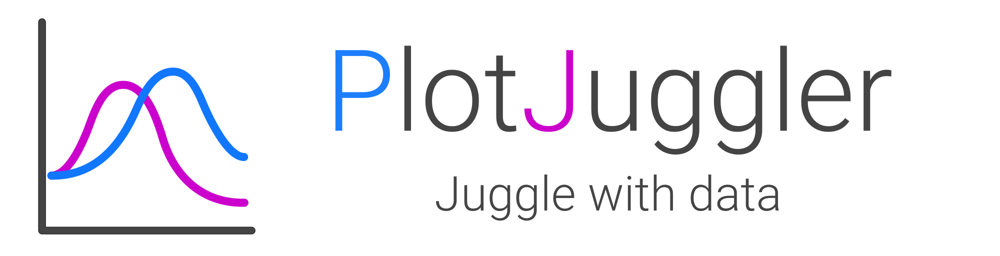
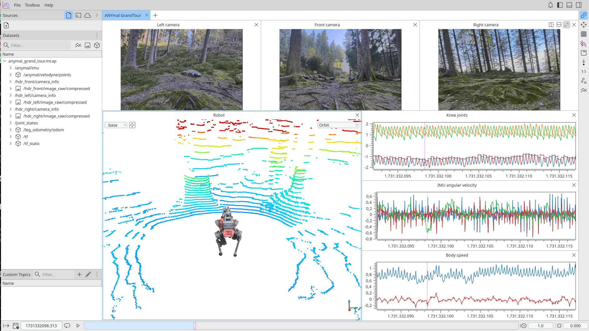

[](https://github.com/PlotJuggler/PlotJuggler/actions/workflows/linux-ci.yml?query=branch%3Amain) [](https://github.com/PlotJuggler/PlotJuggler/actions/workflows/windows-ci.yml?query=branch%3Amain) [](https://github.com/PlotJuggler/PlotJuggler/actions/workflows/macos-ci.yml?query=branch%3Amain) [](https://github.com/PlotJuggler/PlotJuggler/actions/workflows/wasm-ci.yml?query=branch%3Amain) [](https://github.com/PlotJuggler/PlotJuggler/actions/workflows/pixi-ci.yml?query=branch%3Amain)


PlotJuggler 4 is an extensible, performant and open-source multi-modal visualization platform.

Explore recorded or live data, compare test runs, and analyze and transform your data,
in a single application.

<!-- Original screenshots: https://plotjuggler.io/videos/pj-scene3D-800.jpg,
     https://plotjuggler.io/videos/pj-plotting-800.jpg,
     https://plotjuggler.io/videos/pj-waymo-800.jpg. -->



# From data to insight

- **Drag and drop your data.** Drag signals into time-series and XY plots, zoom into events, and inspect individual samples.
- **Validate changes across runs.** Load several recordings, align their timelines, and overlay signals to compare behavior.
- **Analyze the signal.** Filter noise, measure rates of change, integrate values, or inspect frequency content with Fast Fourier Transforms.
- **Add your own functions.** Create derived series with custom transforms in Lua and Python, alongside the built-in filters.
- **Reuse your analysis.** Arrange plots in tabs and dockable panels, then save your layout and transforms for the next investigation.

## Multimodal visualization

Efficient data storage, GPU-accelerated rendering and on-demand media decoding
help keep large recordings responsive as you explore.

<table>
  <tr>
    <td valign="top">
      <h3>Images and Videos</h3>
      <ul>
        <li>Raw and encoded images</li>
        <li>H.264, H.265 or AV1 video</li>
        <li>Live video streaming through WebRTC</li>
        <li>2D annotations and markers</li>
      </ul>
    </td>
    <td valign="top">
      <h3>3D rendering</h3>
      <ul>
        <li>Pointcloud, including compressed</li>
        <li>Meshes and URDF robot models</li>
        <li>Occupancy grids and maps (2D)</li>
        <li>Elevation grid maps (2.5D)</li>
        <li>3D annotations, trajectories and markers</li>
      </ul>
    </td>
  </tr>
</table>

## Whatever your data is, we've got you covered

Open supported formats directly and connect to your existing sensor and messaging
systems. Install ready-to-use loaders, streamers and tools through
**File → Marketplace**:

| Sources | Formats |
| --- | --- |
| **Files** | CSV, MCAP, Parquet, PX4 ULog, LeRobot, MP4, PCD and PLY |
| **Live streams** | ROS 2, MQTT, ZeroMQ, UDP, WebSocket bridges, WebRTC and Lab Streaming Layer |
| **Message encodings** | ROS 1/2, Protobuf, JSON, CBOR, BSON, Apache Arrow and MessagePack |
| **Cloud storage** | [Mosaico](https://mosaico.dev/) |

Need a custom integration? Build a loader, streamer, parser or toolbox with the
[plugin SDK](https://github.com/PlotJuggler/plotjuggler_sdk), or start from the
[official plugins](https://github.com/PlotJuggler/pj-official-plugins).

## Claude Code and Codex plugins

The [PlotJuggler agent plugin](https://github.com/PlotJuggler/plotjuggler-agent)
lets Claude Code and Codex open your logs, read and compute over signals, create
derived series and markers, build plots and 3D scenes, and take screenshots.

Claude Code:

```bash
claude plugin marketplace add PlotJuggler/plotjuggler-agent
claude plugin install plotjuggler@plotjuggler
```

Codex:

```bash
codex plugin marketplace add PlotJuggler/plotjuggler-agent
codex plugin add plotjuggler@plotjuggler
```

Then ask, for example: *"Open ~/logs/run3.mcap in PlotJuggler and plot the wheel speeds."*

> Required version 4.2 or higher.

## How to get started

Every build is attached to the
[latest release](https://github.com/PlotJuggler/PlotJuggler/releases/latest).
Pick the one that fits your system.

### Windows

Download `PlotJuggler-<version>-Windows-x64.exe` from the
[latest release](https://github.com/PlotJuggler/PlotJuggler/releases/latest)
and run it.

To run it without installing, download
`PlotJuggler-<version>-Windows-x64-portable.zip` instead, extract it anywhere
and start `bin\PlotJuggler4.exe`.

### Debian and Ubuntu (apt repository)

Recommended on Ubuntu 22.04+ and Debian 12+: add the apt repository once, and
future releases arrive with `sudo apt upgrade`.

```bash
curl -fsSL https://apt.plotjuggler.io/pj4_install.sh | sudo sh
```

### Any Linux distribution (AppImage)

Download `PlotJuggler-<version>-x86_64.AppImage` from the
[latest release](https://github.com/PlotJuggler/PlotJuggler/releases/latest),
then make it executable and run it:

```bash
chmod +x PlotJuggler-*-x86_64.AppImage
./PlotJuggler-*-x86_64.AppImage
```

It needs glibc 2.35 or newer (Ubuntu 22.04 and later, or equivalent).

### Conda and pixi

The `plotjuggler4` package on the
[prefix.dev `plotjuggler` channel](https://prefix.dev/channels/plotjuggler)
is built for Linux x86_64 and macOS arm64 (macOS 14+):

```bash
pixi global install -c conda-forge -c https://prefix.dev/plotjuggler plotjuggler4
```

### Building from source

For compilation and development setup, see [Building from source](docs/BUILDING.md).

## Continuous integration

A pull request merges only when every check that ran on it is green. Draft PRs run nothing until they are marked
ready.

**On every pull request:**

| Workflow | What it checks | Skipped when the PR touches only |
|---|---|---|
| Linux CI | Build, every test, QRhi display tests (OpenGL 3.3 floor, Vulkan), floating docks across pixel ratios | docs, Markdown, packaging |
| Windows CI | Build, every test, QRhi display tests on D3D11 (WARP) | docs, Markdown, packaging |
| WASM CI | Browser build and its smoke specs in Chromium; the full Chromium suite when the PR touches the browser build | docs, Markdown, `.claude/` |
| pre-commit | Formatting, forbidden patterns, file hygiene | never skipped |

**Only on pull requests that touch their area:**

- **macOS CI** (Metal QRhi tests and the unit tests): toolchain pins, the build system, vendored code, or the widget
  and render code the QRhi tests cover. Start it by hand for any other Metal-sensitive change:
  `gh workflow run "macOS CI" --ref <branch>`.
- **Pixi CI** (conda-forge build and tests, Linux and Windows): `pixi.toml` and `recipes/`.
- **Nix**, **conda** and **macOS dmg** packaging: their files under `packaging/`.

**Nightly on `main`** (UTC; a workflow is skipped when `main` has not moved since its last scheduled run):

| Time | Workflow | What it adds to the PR checks |
|---|---|---|
| 01:00 | macOS CI | Metal QRhi tests and unit tests, plus the QRhi tests on OpenGL (Apple's software renderer) |
| 02:00 | Pixi CI | The conda-forge build on Linux and Windows |
| 03:00 | Sanitizers | The whole suite under ASan, TSan and MSan |
| 04:00 | WASM CI | The full Chromium suite and the Firefox suite, on GitHub-hosted runners |

A failed nightly opens (or comments on) a `Nightly failure: <workflow>` issue; the next green run closes it.

The badges at the top show the latest run on `main`: the push after each merge for Linux and Windows, the latest
nightly or manual run for macOS, WASM and Pixi.

## License

Released under the [Mozilla Public License 2.0](LICENSE).
Third-party dependencies retain their own licenses.
