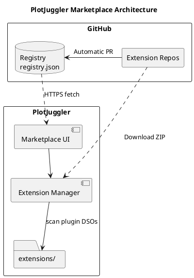
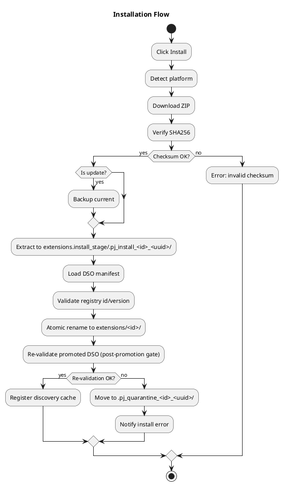
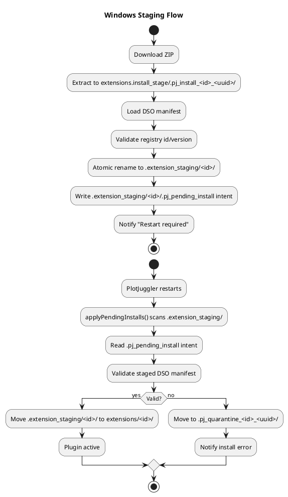
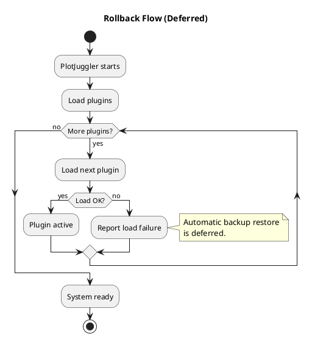

# PlotJuggler Marketplace — Architecture

How the marketplace is designed and built, as it is now. The original March 2026 proposal (plugin template, release CI for extension repositories, UI mock-ups) is kept verbatim in the frozen [v1.0.0 spec](./plotjuggler-marketplace-spec-v1.0.0-en.md); it is history, not guidance.

---

## 1. System Overview

### 1.1 High-Level Architecture


<details>
<summary>PlantUML source</summary>


</details>

### 1.2 Design Principles

| Principle | Rationale | Implementation |
|-----------|-----------|----------------|
| **Serverless** | Zero infrastructure costs | GitHub hosts everything |
| **CI-first** | Lower barrier for developers | Template with automated release |
| **Cross-platform** | PlotJuggler runs everywhere | Matrix build in CI |
| **Static linking** | Avoid dependency hell | Single .so/.dll per plugin |
| **No Qt in data plugins** | ABI stability | Plugins talk to the host through the SDK's C ABI; Widget plugins are the one family that links Qt (§6) |
| **Dogfooding** | Ensure process works | Official plugins use same template |

---

## 2. Design Decisions

### 2.1 PlotJuggler Integration

Two approaches were considered: create an external plugin management tool (like `pip` or `npm`) or integrate it directly into PlotJuggler. The decision was clear: **native integration**.

The reasoning is that the typical PlotJuggler user doesn't want to leave the application to install plugins. They want to open a window inside PlotJuggler, search for what they need, install it, and keep working. It's the VSCode experience, not managing packages from a terminal.

The module ships **both as static libraries embedded in PJ4 and as a standalone Qt app**:

- `pj_marketplace` — static library with the core (`DownloadManager`, `ExtensionManager`, `RegistryManager`, the store layer, `PlatformUtils`, `QtDiagnosticBridge`).
- `pj_marketplace_ui` — static library with the Qt UI (`marketplace_window`).
- `pj-plugin-check` — the Qt-free admission helper executable (§4.9).
- `pj_marketplace_app` — standalone executable that links both libraries, built when `PJ_BUILD_MARKETPLACE_APP` is on (it defaults to `PJ_BUILD_TESTS`).

The standalone executable continues to exist precisely because it lets us iterate on the marketplace without rebuilding the whole PJ4 shell. The embedded `pj_app` integration consumes the same `pj_marketplace` / `pj_marketplace_ui` libraries, so behaviour stays in sync between the two entry points.

### 2.2 Artifacts are independent of the build tool

A ZIP with one or more plugin DSOs installs the same whether it was built with Conan, Pixi or by hand: installed metadata is read from each DSO's embedded manifest, and the registry only needs direct URLs to the ZIP artifacts. How an extension repository builds and releases is not this module's concern (plugin authoring is documented in the SDK and in `pj-official-plugins`).

### 2.3 Sizing

The system is designed for a modest catalog:

- **Current plugins:** ~20
- **Expected short-term:** ~30
- **Maximum estimate:** 40-50

This means a simple JSON file is more than sufficient as a registry. We don't need a database, we don't need sophisticated search. A JSON with 50 entries loads in milliseconds.

---

## 3. Component Design

### 3.1 Core Components

Public headers live under `include/pj_marketplace/`; sources under `src/core/` (managers, store, extraction), `src/models/` (the pure value types: content manifest, generation digest, loaded profile, store policy), `src/ui/` (`marketplace_window.{cpp,ui}`) and `helper/` (`pj-plugin-check`). The headers by role, so nothing here gets written twice:

- **Managers:** `extension_manager.hpp` (install, update, uninstall, enable, staged promotion, diagnostics), `registry_manager.hpp` and `registry_resolver.hpp` (fetch, then the pure candidate selection), `download_manager.hpp` (HTTP, checksum, extraction).
- **Admission:** `plugin_compatibility.hpp` (the ABI major / `min_sdk_required` claims of one descriptor and their gate), `plugin_check_runner.hpp` (parent side of the `pj-plugin-check` child process), `version_compare.hpp` (`comparePluginVersions`, the one version ordering every badge and lock uses).
- **Store layer:** `store_session.hpp` and `store_lease.hpp` (canonical store root, its sibling directories, the single-writer lease), `artifact_store.hpp` (immutable content-addressed objects), `loaded_profile.hpp` (id → object digest), `content_manifest.hpp` and `generation_digest.hpp` (the content identity), `store_policy.hpp` and `archive_limits.hpp` (size, entry and depth budgets), `store_rejection.hpp` (the stable refusal codes), `stored_file.hpp`.
- **Helpers:** `sha256.hpp` (incremental SHA-256, file streaming), `fs_walk.hpp` (recursive regular-file walk that fails closed on symlinks), `platform_utils.hpp` (platform id, standard paths, `canonicalStoreRoot`), `qt_diagnostic_bridge.hpp`.
- **Value types and UI:** `extension.hpp` (a registry entry), `installed_extension.hpp` (an installed one), `marketplace_window.hpp`, `marketplace.hpp` (aggregate include).

### 3.2 Data Models

`Extension` (`extension.hpp`) is one registry release: identity and presentation fields, `min_sdk_required`, its plugins, and `platforms`, a map from platform id (`linux-x86_64`, ...) to `{url, checksum}` with the checksum as `sha256:<hex>`. `InstalledExtension` (`installed_extension.hpp`) is one installed directory; its fields are read from the DSO's embedded manifest, so a plugin the registry does not list can still be shown as a row and gated on every host contract it declares. `min_plotjuggler_version` is parsed and shown in both, and never gates.

### 3.3 Component Responsibilities

| Component | Responsibility | Dependencies |
|-----------|---------------|--------------|
| **RegistryManager** | Fetch and parse JSON (no cache today — see REQUIREMENTS F-11), then invoke the headless resolver | QNetworkAccessManager, PlatformUtils, RegistryResolver |
| **RegistryResolver** | Validate registry SemVer/invariants and select one platform/host-appropriate release per id | Qt Core value types, SDK SemVer |
| **ExtensionManager** | Install, uninstall, update, staged promotion, ring-buffer diagnostics, optional `PJ::DiagnosticSink` fan-out | DownloadManager, PlatformUtils, plugin catalog |
| **DownloadManager** | HTTP GET with progress, SHA256 verification, ZIP extraction | QNetworkAccessManager, QCryptographicHash, libarchive |
| **PlatformUtils** | Detect OS, get paths | Qt platform macros |
| **QtDiagnosticBridge** | Exposes a `PJ::DiagnosticSink` via `sink()` and re-emits each received `PJ::Diagnostic` as a thread-safe queued Qt signal `diagnosticReported(int level, QString source, QString id, QString message)` (queued delivery guarded by `QPointer`). Lets a host hand a Qt-free sink to non-GUI components (e.g. `ExtensionManager`, which takes a `DiagnosticSink` ctor param) and connect the signal to its UI. | Qt signals/slots |

#### Registry ingestion and headless candidate resolution

`RegistryManager` parses every record before making a host-specific choice. The
pure `resolveRegistryCandidates()` function then validates every extension
version and SDK floor with SDK `PJ::SemVer` and returns one
row per id. It selects the highest compatible release for the current platform;
if none is compatible, the highest release for that platform remains visible as
blocked; if the platform has no artifact, the highest release overall remains
available to non-filtering consumers. A registry that repeats the same semantic
`(id, version)` slot is rejected, including versions that differ only in build
metadata. All platform artifacts for one release belong in one immutable record.
Parsing therefore never destructively discards a candidate before eligibility is
known, and the resolver can be tested without network, filesystem, QObject, or UI.

#### ExtensionManager — Constructor Design

All dependencies are injected via constructor. The extensions directory defaults to
`PlatformUtils::extensionsDir()`, allowing tests to point to a temp directory without
mocking `PlatformUtils`:

```cpp
explicit ExtensionManager(DownloadManager* downloader,
                          const QString& extensions_dir = PlatformUtils::extensionsDir(),
                          const QString& pending_dir = PlatformUtils::pendingDir(),
                          DiagnosticSink sink = {},
                          QObject* parent = nullptr);
```

A companion no-arg `ExtensionManager()` overload also exists; it creates an owned
`DownloadManager` and uses the standard user directories.

**Design decisions:**
- The extensions directory is fixed at construction time; the platform id comes from `PlatformUtils::currentPlatform()`
- Local installation state (`QMap<QString, InstalledExtension>`) is a private cache in `ExtensionManager` — populated at construction by scanning `extensions_dir`, loading plugin DSOs, and reading their embedded manifests; testability is preserved via the `extensions_dir` parameter pointing to a temp directory
- No local installed-state sidecars — disk is scanned, but `id` and `version` come from the embedded DSO manifest
- Staged updates write a transient `.pj_pending_install` intent containing the registry id/version. It is deleted after promotion and exists only so restart-time validation can compare the staged DSO against the registry request that created it. Both the id and the version inside the intent file are validated against the same safe-path/regex rules used elsewhere, so a tampered intent cannot escape `extensions_dir`.
- Embedding apps may seed the marketplace with a loaded-plugin snapshot before first render. That snapshot is initialization data, not a second source of truth; the embedded manifest remains the authority for installed state.
- **Pending queues drained at construction.** `ExtensionManager::initComponents()` runs `applyPendingUninstalls()` then `applyPendingInstalls()` before computing the installed snapshot, so restart-deferred work is processed regardless of which `MarketplaceWindow` constructor (or host wiring) ends up using the manager.
- **Duplicate-directory cleanup runs after the whole promotion loop.** `applyPendingInstalls()` first promotes every staged directory, then replaces prior same-id directories (`replaceConflictingInstallDirs`). The cleanup scan dlopens sibling directories to read their embedded ids, and opening a sibling's not-yet-promoted DSO would pin its old image in the process (glibc never unloads a DSO whose `STB_GNU_UNIQUE` symbols were bound), making the post-drain rescan report pre-update versions and the marketplace re-offer updates already on disk.
- **Removal intent is journalled outside the payload, and honors write failures.** `uninstall()` and `downgradeToBundled()` record `{schema, operation, id, path}` under `extensions.state/` (see §4.6) instead of writing a marker into the directory being deleted — a partially failed recursive delete would otherwise destroy its own retry record. Every record is a deletion capability and is fully validated before use (schema, exact operation, id matching the filename, target confined to a direct child of the canonical store root); a refused record is quarantined and reported, never acted on. `writeRemovalIntent` returns `bool`; if the record cannot be committed the in-memory entry is left intact, the enable state is rolled back, and `uninstallError` is emitted, so a removal that cannot be recorded does not silently revert on the next start. Markers older builds left inside payloads become path-only `cleanup` records that carry no id authority; their content is never trusted.
- **Broken staged installs are quarantined, not retried forever.** When `applyPendingInstalls` fails to remove a rejected stage, the directory is renamed to `.pj_quarantine_<name>_<uuid>/` next to it. The next startup ignores quarantine entries and reports the path in the diagnostic so the user can inspect and clean it up.

#### ExtensionManager — Diagnostic propagation

`ExtensionManager` exposes its diagnostics three ways simultaneously:

| Channel | Audience | Notes |
|---------|----------|-------|
| `diagnostics()` accessor + 50-entry ring buffer | UI snapshot at any time | The marketplace window's "Diagnostics" dialog reads this. |
| `diagnosticReported(QString id, QString message, bool is_error)` Qt signal | Standalone marketplace UI | Pushes into the status bar. |
| Optional `PJ::DiagnosticSink` constructor parameter | Embedding hosts | Lets `PluginRegistry`, `ExtensionManager`, and any other module feed one chronological stream into a single GUI sink. |

See the SDK's `pj_base/diagnostic_sink.hpp` for the sink contract; the standalone `pj_marketplace_app` does not pass a sink, preserving the previous behavior unchanged.

---

## 4. Key Flows

### 4.1 Installation Flow

Both the immediate (Linux/macOS) and deferred (Windows) paths extract the
download into a hidden transaction directory (`.pj_install_<id>_<uuid>/`) under
`extensions.install_stage/` — a **sibling** of the extensions dir, so it shares
that dir's filesystem (the promoting rename stays atomic) while staying outside
the recursive plugin scan. Inside the scanned tree, a transaction holding an
unpacked DSO would be discoverable, loadable content, and it survives a crash;
the scanner applies no exclusion rule of its own. The DSO is **opened and its
embedded manifest validated** inside
the transaction directory before promotion (by a child process, §4.9), then **re-validated at the final
location** after the rename — this catches DSOs that depend on rpath/relative
paths that hold in the staging area but break in `extensions/`. On failure
the transaction directory is removed and no partial state survives.

A sideloaded archive gets one extra gate between the compatibility check and the
replacement question: if the extracted tree hashes identically to the installed
one, the operation finishes there. Nothing is asked, staged, or promoted, because
the bytes being offered are the bytes already running — see
[§4.7](#47-identical-payload-short-circuit).


<details>
<summary>PlantUML source</summary>


</details>

### 4.2 Windows Staging Flow


<details>
<summary>PlantUML source</summary>


</details>

### 4.3 Rollback Flow

Every successful update — Linux, macOS, and Windows — moves the previous
version into `.backup/<id>-<oldversion>/` before the new version takes its
place. On Linux/macOS this happens synchronously inside `update()`; on
Windows it happens at restart inside `applyPendingInstalls()`, just before
the staged directory is renamed over the existing one. If the staged
promotion fails after the backup move, `applyPendingInstalls()` attempts
to roll the backup back into place; if even the rollback fails, the
diagnostic surfaces both paths so the user can recover manually.

Automatic *post-load* rollback (restoring from backup if the freshly
installed plugin later fails to load) is deferred. The backup directory
is the manual recovery point.


<details>
<summary>PlantUML source</summary>


</details>

### 4.4 Bundled (Core) Extensions

Plugins shipped inside an installed build or AppImage live in the **bundled
dir** (`<prefix>/lib/plotjuggler/plugins`, resolved relative to the
executable). That dir is a **seed source only** — it is never scanned as a load
path. The split of responsibilities:

- **Host side** (`pj_runtime`'s `ExtensionCatalogService`, at every startup, in
  every mode): syncs the bundled dir into the default extensions dir *before*
  the plugin scan and *after* `ExtensionManager` applied pending staged
  actions. Per bundled id — absent/unreadable → copy; installed older than
  bundled → refresh (staged copy in an `extensions.seed_stage/` **sibling** of
  the extensions dir — outside the scanned tree — then a rename swap, so a
  failed refresh keeps the working copy); installed same-or-newer → untouched.
  Comparison is version-only (`PJ::comparePluginVersions` from
  `pj_marketplace/version_compare.hpp` — the same rule the uninstall lock,
  downgrade, and update badges use), never content; in the steady state a
  size+mtime signature match against the bundled DSO (copies are stamped with
  the bundled mtime) skips the installed-side manifest read entirely.
- **Marketplace side**: the host hands the bundled id → version map to
  `ExtensionManager::setBundledVersions()`. Membership makes an id **core**:
  `isBundled()` locks uninstall, and `downgradeToBundled()` stages a revert to
  the shipped version when the installed one is ahead (applied on restart, like
  any staged action). No per-folder marker — the lock is by id, so it survives
  updates.
- **Mode scoping**: the map is handed over only when the `ExtensionManager` is
  rooted on the default extensions dir. In a `--plugin-dir` session the manager
  governs the override folder, where a same-id copy is user-owned — nothing is
  core there, while the seed still targets the default dir.

Folder precedence at load time is host policy (`PluginRuntimeCatalog`):
`--plugin-dir` override → custom Preferences folders → extensions dir; the
user-explicit tiers win duplicate ids version-blind.

### 4.5 Single-Writer Lock

A managed store has **one writer at a time across processes**. Constructing an
`ExtensionManager` takes a `QLockFile` on `<config-root>/.extensions.lock`
(`acquireStoreLock`, before any cleanup runs). The holder behaves as described
everywhere else in this document; an instance that cannot take the lock runs
**read-only** — it still scans and reports installed state, but install,
sideload, update, uninstall, downgrade-to-bundled, enable/disable and the
startup drains all refuse with *"Another PlotJuggler instance is managing
extensions."* `hasStoreWriteAccess()` exposes the mode so a UI can disable those
actions up front.

Why it exists: startup cleanup deletes every `.pj_install_*` transaction
directory it finds, and nothing in the name says which process owns it. Without
the lock, a second PlotJuggler starting up deletes the extraction directory of a
download the first one is still running. With it, cleanup only ever runs in the
process holding the lock and every live writer holds it, so the only
transactions a drain can meet are its own or those of a process that is no
longer alive. Staleness is decided by the owner PID's liveness alone
(`setStaleLockTime(0)`): a crashed writer's lock is reclaimed, a slow writer's
is never stolen.

Two failures reach the user through separate messages, because they call for
opposite actions: `LockFailedError` is a live competitor ("close it and restart
PlotJuggler"), while `PermissionError`/`UnknownError` mean this config dir cannot
hold a lock file at all and name the file instead. Neither promises a retry —
nothing reacquires the lease mid-session, so a read-only session stays read-only
until the next launch.

The lock file is a **sibling** of `extensions/`, never a file inside it
(everything under the store is treated as extension payload). Its name is derived
from the store's **canonical** path — via `PlatformUtils::canonicalStoreRoot()`,
the one policy every store sibling follows (writer lease,
`extensions.install_stage/`, and the seed's `extensions.seed_stage/` in
`pj_runtime`). So a `--plugin-dir` session or a test over its own temp dir never
contends with the default store, while two *names* for one store (a symlinked
install) always contend instead of handing out two leases. The same resolution
keeps every staging sibling on the store's filesystem, which is what makes
promote-by-rename atomic; an install whose staging area lands on a different
filesystem is refused rather than degraded to a copy.

`ExtensionCatalogService::seedBundledPlugins()` (`pj_runtime`) is the one store
writer outside `ExtensionManager`'s mutating API, so it is gated on
`hasStoreWriteAccess()` too and skips with a diagnostic in a read-only session.
### 4.6 Removal Journal (staged uninstall / downgrade)

A removal cannot happen when the user asks for it: the DSO is loaded, and on
Windows locked. Both `uninstall()` and `downgradeToBundled()` therefore record the
intent and let `applyPendingUninstalls()` perform it at the next launch.

That intent lives in `extensions.state/<id>.json`, holding
`{schema, operation, id, path}` — committed with `QSaveFile`, so a reader never
sees a half-written record and a crash mid-write leaves the previous state. The
journal root is derived from the **canonical** store root, so two aliases of a
symlinked store share one journal rather than keeping divergent records.

**Why outside the payload.** The journal is a sibling of `extensions/` for the
same reason as `extensions.install_stage/` (outside the recursive plugin scan),
plus one that is specific to removals: `QDir::removeRecursively()` deletes
children *before* it can fail on the one it cannot unlink. An intent stored
inside the directory being deleted is therefore destroyed by its own partially
failed deletion — the payload survives with its locked DSO while the record that
would have retried the removal is gone. The journal cannot be consumed by the
deletion it describes.

**A record is a capability, so every record is validated.** Processing one runs
`QDir::removeRecursively()` on the path it names, and the store lease does not
protect against this: records live inside the rightful writer's own state
directory, so corruption — or anything able to drop a file there — would
otherwise inherit that privilege. `parseRemovalIntent()` refuses a record unless
**all** of the following hold, and nothing is defaulted, inferred, or repaired:

- it declares the current `schema`;
- `operation` is exactly `uninstall`, `downgrade`, or `cleanup` (absent or
  unrecognised is invalid — never read as `uninstall`, the destructive choice);
- for an id-bearing operation, `id` passes the filesystem-safety rule **and
  equals the filename stem**, so a record cannot be filed under one name and
  speak for a different extension;
- `path` is absolute and a **direct child of the canonical store root**. That one
  rule rejects the store root itself, any ancestor, an unrelated absolute path,
  anything reached through `..`, and the sibling `state` / `install_stage` /
  `seed_stage` roots and lease file (siblings are not children). Confinement is
  re-checked on the *canonical* target, so a symlink planted inside the store
  cannot carry the deletion out of it.

The store root the comparison is made against is canonicalized **once at
construction**, so a symlinked config or home does not put a record's lexical
parent and the canonical root on different footings and strand every valid
uninstall.

Confinement runs a **second time at the moment of deletion**, because
parse-time skips the canonical check for a target that did not exist yet (there
was nothing to abuse then) — leaving a startup-race window in which a
matching-named symlink could be planted before the drain. A managed payload is a
real directory, so a symlink at the target is refused outright (`removeRecursively`
would otherwise follow it), and confinement is re-evaluated against what is on
disk now.

A refused record is **quarantined** (renamed `*.rejected-<uuid>`, keeping the
evidence while taking it out of the `*.json` glob so it is not re-refused every
launch) and reported as a diagnostic — never silently skipped. On success the
**exact record file that was parsed** is retired, never a name recomputed from
the id it claims.

**Write order.** `uninstall()` persists the disabled entry *first*, syncs it, and
**checks `QSettings::status()`** — an unwritten setting is not persistence, and
the staged-removal contract depends on that entry surviving a crash. Only then is
the record committed. The loader decides what to load from the disabled list
alone, so the only state a crash can expose mid-stage is "unloadable but still
installed": recoverable, and never a removed plugin quietly coming back. Any step
that cannot be persisted rolls the enable state back (itself synced and checked)
and fails the operation.

**Tombstones: the drain can never enable anything.** A successful removal drops
the record but **keeps** the id's disabled entry, as a tombstone. The files are
gone, so the entry costs nothing — and because it is never cleared here, journal
processing needs no authority over enable state at all. No record, however
corrupt or hostile, can make a plugin loadable, and a same-id copy left elsewhere
on disk cannot be resurrected by a deletion elsewhere. A fresh install clears the
tombstone (`registerInstalledExtension` with `preserve_disabled_state=false`), so
reinstalling is what brings an id back. `downgrade` never writes a tombstone: it
is a version change, and the restored bundled version inherits the user's
enable/disable choice unchanged.

**Trust boundary — legacy in-payload markers.** Older builds wrote a
`.pj_pending_uninstall` marker inside the payload. Each such directory is
converted into an external record *before* anything is deleted, so the retry
survives a partial failure like any other. The marker's *content* is never read:
it is package-controlled filesystem content — an archive can ship one naming any
id — so honouring it would let a package steer an unrelated extension's state.
The derived record is `cleanup`, which carries **no id and therefore no authority
over any extension**; it only deletes, and is path-confined exactly like every
other record. Externalization is idempotent: a marker whose delete keeps failing
is not re-filed while a live `cleanup` record already targets its directory, so
the journal does not grow a record per launch.

### 4.7 Identical-payload short-circuit

Rebuilding a plugin and sideloading it again is routine, and most of those
rebuilds change nothing. Replacing a live extension is the expensive, risky part
of an install — it stages a copy and defers promotion to the next launch, because
the running session may hold the DSO open. Doing that to install the bytes
already on disk is pure cost, so `installFromLocalZip()` refuses to.

**Identity.** `inspectContentManifest()` walks the tree and returns every file as
a relative path plus the SHA-256 of its contents;
`aggregateContentManifestDigest()` folds that sorted list into one digest. Paths
take part in the identity, so moving a file is a change. Archive timestamps and
compression do not, so the same sources repackaged twice still match. The walk
refuses anything it cannot characterise — a symlink describes a target outside
the tree that can move underneath it — and reports the tree as unreadable rather
than guessing.

**When it fires.** After the compatibility gate, so an archive that would be
refused is still refused whatever it holds, and before the replacement question,
so no dialog is raised for a non-replacement. Both trees are hashed at that
moment rather than trusting a value recorded at install time: an installed tree
edited underneath us then compares different and takes the ordinary path,
repairing itself. An unreadable tree yields an empty digest, which never counts
as a match — two unreadable trees must not pass for the same tree.

It stays out of the way when an install is already staged for that id: the stage,
not the live directory, is what the next launch promotes, so matching against the
live bytes there would drop the archive while leaving a different payload queued.

**What it does not do.** The digest is computed over the *extracted* tree, so the
download and the extraction still happen. What is saved is the promotion, not the
wait. The registry path is untouched — `install()` already refuses an installed
id and `update()` implies a different version.

### 4.8 Content-addressed store

Every successful install is also mirrored into an immutable object store, and the runtime prefers that copy as its load path.

- **Layout.** `StoreSession::open()` canonicalizes the store root once and prepares its siblings on the same volume: `extensions.artifacts/<digest>/` (objects), `extensions.extraction/` (staging) and `extensions.profiles/loaded.json` (extension id → object digest). The session also carries the single-writer lease of §4.5, so the store has exactly one lock.
- **Identity.** An object is named by its content-manifest digest (§4.7), computed the same way for an extracted archive and an adopted directory, so identical bytes share one object whatever their origin.
- **Write path.** After the visible install is final, `ExtensionManager::registerInstalledExtension` adopts `extensions/<id>/` into the store (`ArtifactStore::adoptDirectory`, write-once) and records the digest in the loaded profile. It is best-effort and never gates the user's result: a refused tree (a symlink, a budget, an I/O fault) drops the id's mapping and leaves the classic directory as what loads.
- **Load path.** `ExtensionManager::managedPluginDirs()` is what `pj_runtime`'s `ExtensionCatalogService` scans for the managed tier: one directory per id, the store object when the profile names one and its bytes still verify against the recorded manifest (`verifyArtifact`, a rehash, not an existence check), else `extensions/<id>/`. A present object that fails the check is never loaded and is reported.
- **Collection.** `reconcileStore()` runs at startup after the pending queues drain: it drops profile entries whose `extensions/<id>/` is gone, then deletes objects no entry references. It skips the sweep when the profile is empty while extensions are installed, because that means the profile failed to load and an empty root set would erase the store.

### 4.9 Out-of-process admission

The first look at bytes that just arrived (a registry download, a local archive, a promoted directory being re-validated) is taken by `pj-plugin-check`, a Qt-free child process that `PluginCheckRunner` starts on one directory, with a wall-clock timeout, and whose JSON descriptor list it parses. Two reasons: a plugin that aborts in a static initializer cannot take the application down, and opening a payload at its staging path in this process would pin that image (§3.3, the glibc note) and poison the check at its final path. A helper that produced no verdict (spawn failure, crash, timeout) is reported as unproven, not as a bad plugin. Directories already admitted are still inspected in-process. The runner puts Qt's library directory first on the loader path, because a Widget plugin links Qt.

---

## 5. Directory Structure

### 5.1 Installation Directories

The root is `QStandardPaths::AppDataLocation` (the `PlotJuggler/PlotJuggler4` org/app pair, shared by the embedded host and the standalone app): Linux `~/.local/share/PlotJuggler/PlotJuggler4/`, macOS `~/Library/Application Support/PlotJuggler/PlotJuggler4/`, Windows `%LOCALAPPDATA%/PlotJuggler/PlotJuggler4/`.

```
<config-root>/
├── extensions/                      # Active plugins (marketplace installs and
│   ├── ros2-streaming/              # seeded core extensions alike)
│   │   ├── libros2_streaming.so
│   │   └── ros2_streaming.ui
│   └── csv-loader/
│       └── libcsv_loader.so
├── extensions.seed_stage/           # Transient: bundled-refresh staging,
│                                    # sibling of extensions/ so the scan
│                                    # never sees a half-written payload
├── extensions.install_stage/        # Transient: every install (registry and
│   └── .pj_install_<id>_<uuid>/     # sideload alike) extracts here, another
│                                    # sibling of extensions/ for the same
│                                    # reason; removed once the transaction
│                                    # promotes, swept if a crash orphans it
├── extensions.state/                # Removal journal: one record per pending
│   └── <id>.json                    # uninstall/downgrade, {operation,id,path}.
│                                    # A third sibling, and deliberately NOT
│                                    # inside the payload it describes — see §4.6
├── extensions.artifacts/            # Immutable content-addressed objects (§4.8)
│   └── <digest>/
├── extensions.extraction/           # Transient: store extraction staging
├── extensions.profiles/             # loaded.json: extension id -> object digest
├── .extensions.lock                 # Single-writer lock over extensions/ (§4.5);
│                                    # a second live instance runs read-only
├── .extension_staging/      # Staging area: updates land here and are promoted
│   │                                # on the next startup; a fresh install uses it
│   │                                # only as the post-promotion validation gate
│   └── ros2-streaming/              # Staged update, applied on restart
│       └── .pj_pending_install      # Intent file for restart-time update apply
└── .backup/                         # Pre-update backups (all platforms); automatic rollback deferred — restore manually
    ├── ros2-streaming-1.2.2/
    └── csv-loader-0.9.0/
```

### 5.2 Extension ZIP Structure

```
ros2-streaming-linux-x86_64.zip
├── libros2_streaming.so       # Required: compiled plugin(s)
├── ros2_streaming.ui          # Optional: Qt Creator UI file
├── README.md                  # Optional: description
└── LICENSE                    # Required: license file
```

---

## 6. ABI Compatibility Strategy

### 6.1 Qt and plugins

A plugin compiled against one Qt breaks when the host moves to another, so the data families (sources, parsers, toolboxes) link no Qt: they talk to the host through the SDK's C ABI, and their dialogs are `.ui` files (plain XML) that the host loads through `pj_dialog_host`. A Qt upgrade of PlotJuggler therefore does not touch them.

Widget plugins are the exception: they create real Qt widgets, so they link Qt. The host compares each library's `build_info()` with its own Qt major.minor and compiler family before creating anything, and lists a mismatching library as unusable with its reason (`pj_runtime/docs/ARCHITECTURE.md`, "Widget plugins").

### 6.2 Compatibility Policy

- The gate is the ABI major plus `min_sdk_required`: the registry and the embedded plugin manifest both declare the SDK floor, while discovery supplies the ABI major. A plugin that needs a newer host declares the SDK release that added the surface it needs. `min_plotjuggler_version` is still parsed and shown, but never gates.
- One headless admission evaluator, backed by the SDK's strict `PJ::SemVer`, is shared by registry/local-ZIP admission, pending-install promotion, bundled-seed rescue, static registration, and runtime DSO loading. Plugin versions and floors fail closed when malformed. A multi-DSO extension retains the highest valid floor; invalid metadata keeps the complete extension unloadable without removing its installed marketplace row.
- Registry metadata is only a pre-screen: after extraction the embedded ABI and SDK floor are rechecked before promotion, and staged work is rechecked again at restart. `platforms` remains registry-only; a foreign binary fails DSO discovery before the embedded gate.
- Compatibility is a hard runtime gate. `--plugin-dir` and Preferences folders retain strict shadow priority: an incompatible authoritative copy suppresses a managed same-id fallback but is itself not loaded, making developer override failures explicit instead of silently testing another build.
- The Qt baseline is `PJ_QT_VERSION` in the root `versions.env`.

---

## 7. Build System

### 7.1 CMakeLists.txt (Marketplace)

The actual CMakeLists.txt is the source of truth — see `pj_marketplace/CMakeLists.txt`. Notable points:

- Targets: see §2.1.
- `pj_marketplace` links `plotjuggler_sdk::plugin_host` for embedded-DSO-manifest discovery; a standalone configure (this directory as the CMake root) resolves the SDK itself. `pj-plugin-check` links only that and `nlohmann_json`, so its packaging closure stays Qt-free.
- C++20, `-Wall -Wextra -Werror -Wshadow -Wnon-virtual-dtor -Wold-style-cast -Wcast-qual -Wconversion -Woverloaded-virtual -Wpedantic`.
- Tests are gated on `PJ_BUILD_TESTS`; the runners and why three suites keep their own executable are in `../CLAUDE.md`.

---

## 8. UI

`MarketplaceWindow` is one `.ui`-driven window: a table of extensions (name, category, installed version, marketplace version, description) with a search box and filter toggles, and a details footer for the selected row that carries the secondary actions (uninstall, enable/disable). There is no separate detail dialog. End-user behaviour is in [`USER_MANUAL.md`](./USER_MANUAL.md).

---

## 9. Technology Decisions

| Decision | Choice | Alternatives Considered | Rationale |
|----------|--------|------------------------|-----------|
| GUI Framework | Qt 6 Widgets | QML | Consistency with PlotJuggler |
| HTTP Client | QNetworkAccessManager | libcurl | Already in Qt, no extra deps |
| JSON Parsing | QJsonDocument | nlohmann/json | Already in Qt |
| ZIP Library | libarchive | QuaZip, minizip, libzip | Already used by `DownloadManager`; supports ZIP extraction without Qt-specific archive wrappers |
| Checksum | QCryptographicHash | OpenSSL | Already in Qt |
| Build System | CMake + Conan | Meson, Bazel | Industry standard, team experience |

---

## 10. Integration with PlotJuggler

`pj_app` opens the marketplace from **File ▸ Extensions Marketplace…** (`MainWindow::onOpenMarketplace`). It is embedded in the central area like a toolbox, not shown as a modal dialog: `MainWindow` constructs a `MarketplaceWindow` over the session's `ExtensionManager` and the registry URL from Preferences, keeps it alive as a hidden controller, and lifts its `contentWidget()` into a banner-wrapped panel that can be closed or moved to a tab. When the panel closes and `installationsChanged()` is true, the shell reloads the plugin catalog. The gear button emits `pluginPreferencesRequested`, which the shell answers by opening Preferences ▸ Plugins; the marketplace has no dependency on the preferences UI.
